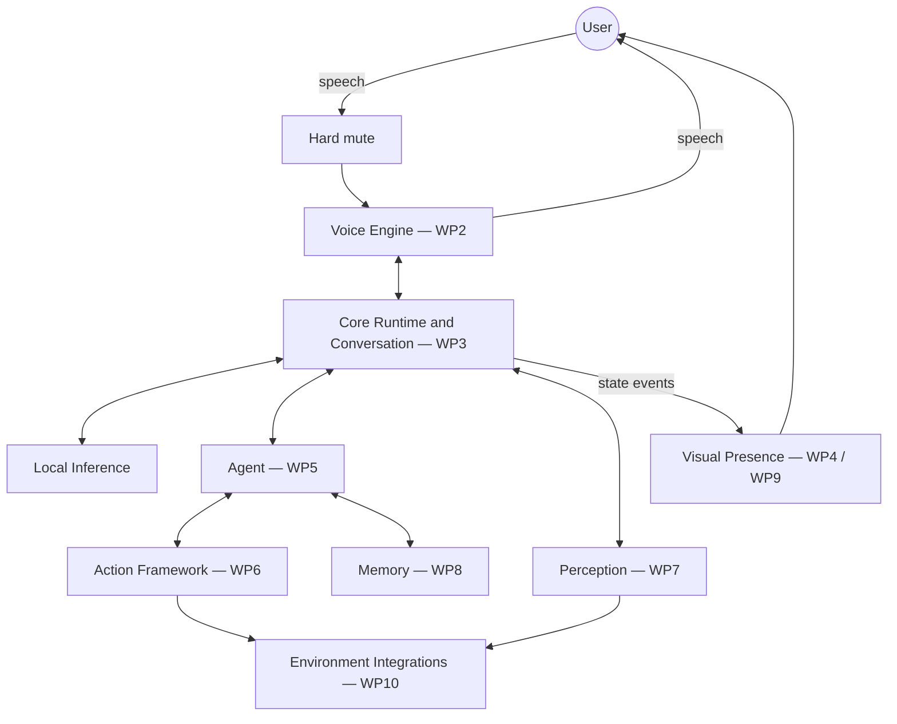

# Autum — Project Development Plan

*Revised 2026-11-22.*

**Project goal:** Build a local AI assistant that communicates through
real-time speech, has a visual presence, understands user-provided
environmental information, and can carry out tasks under user
supervision.

This plan prioritizes a usable voice-first assistant before expanding
into autonomous task execution, environmental perception, persistent
memory, desktop integrations, and a human-like animated character.

The plan does not lock Autum to a desktop environment, compositor, Linux
distribution, programming language, hardware configuration, or inference
framework.

---

## 1. Product principles

### 1.1 Voice-first, not agent-framework-first

The first useful version of Autum must deliver a complete spoken
conversation. It must listen, understand when the user has finished,
respond with speech, and allow the user to interrupt it.

The first release is not required to operate the desktop autonomously,
continuously observe the screen, or render a realistic human character.

### 1.2 The interaction is the product

Voice, conversation, visual state, and cancellation must work together
as one experience. They should not be treated as unrelated components
that are integrated only near the end.

### 1.3 Local-first operation

Core inference and processing run locally. Network access is limited to
explicitly enabled integrations and model downloads. The system must
remain useful without a cloud AI service.

Development tooling follows the same rule: prefer local, account-free
tools. Any tool, asset source, or service that needs an account, sign-up,
or online processing requires explicit approval before it is used.

### 1.4 Replaceable components

Models, audio providers, perception providers, desktop integrations, and
the visual interface communicate through documented interfaces. The core
runtime must not depend on one model vendor or desktop environment.

### 1.5 Evidence over assumptions

Model choices, latency targets, memory budgets, and quality claims must
be supported by reproducible tests on the reference machine. A component
is not considered complete merely because it starts successfully.

---

## 2. Product requirements

| ID | Requirement | Expected result |
|---|---|---|
| AUT-01 | Local operation | Core intelligence and processing run locally |
| AUT-02 | Speech-to-speech | User can speak and receive spoken responses |
| AUT-03 | Real-time interaction | Streaming responses, interruption, and cancellation |
| AUT-04 | Visual presence | Persistent visual identity with accurate runtime states |
| AUT-05 | Environmental perception | Understand explicitly supplied visual and contextual information |
| AUT-06 | Action execution | Perform operations through controlled capabilities |
| AUT-07 | Supervised autonomy | Request approval for actions requiring permission |
| AUT-08 | Context | Maintain conversation and task context |
| AUT-09 | Memory | Retain selected information across sessions |
| AUT-10 | Reliability | Recover from failures and verify completed actions |
| AUT-11 | Security and privacy | Observed content is untrusted; sensitive data is protected; listening and observing are visible |

**Language:** English for the first release. Each additional language
needs its own recognition and synthesis evaluation in WP1.

### 2.1 Initial performance objectives

These are objectives for benchmarking, not binding acceptance criteria
before a working baseline exists. M1 records measured baseline
performance and proposes realistic acceptance thresholds. Targets can
then be revised with evidence.

| Metric | Initial objective |
|---|---|
| End of user speech → first audible reply | Aim for ≤ 800 ms median and ≤ 1.5 s p95; validate feasibility |
| Interruption: user starts speaking (hands-free) or presses push-to-talk → Autum audio stops | Aim for ≤ 200 ms |
| Premature end-of-turn (hands-free) | Aim for < 5% on a representative test set |
| False interruption (hands-free): noise, backchannels such as "mm-hm", other voices, or Autum's own echo stop playback | Aim for < 2% of responses |
| Character state lag | Aim for ≤ 100 ms |
| Lip-sync offset | Aim for ±80 ms once facial animation exists |
| Continuous session | At least 8 hours without restart or unbounded memory growth |
| Resource use | Complete active model set fits in reference GPU memory with headroom, or uses a measured loading strategy |

How to measure:

- **End of user speech** is the true end of speech in the recorded
  audio, annotated in the test set. It is not the moment the endpoint
  detector fires. Otherwise the endpoint delay hides inside the number.
- **First audible reply** is the first output sample reaching the audio
  device, not the first generated token or synthesized chunk.
- Measure with the visual interface running, because the renderer and
  the models share the GPU.

Do not claim that a target is met from isolated model benchmarks.
Measure the complete running pipeline.

### 2.2 Reference hardware

| Component | Reference machine |
|---|---|
| CPU | AMD Ryzen 7 5800XT (8 cores / 16 threads) |
| RAM | 32 GB |
| GPU | NVIDIA GeForce RTX 4060 Ti, 16 GB VRAM |

The 16 GB VRAM capacity is a primary constraint. Measure the combined
memory requirements of the active speech, reasoning, and optional
perception models, plus the visual interface's GPU use. Test model
loading and unloading where simultaneous residency is not feasible.
Define minimum supported hardware only after M1.

---

## 3. User experience and interaction model

### 3.1 Dedicated voice experience

Autum must have a dedicated voice interaction mode rather than treating
voice as a microphone button attached to a text chat.

Interaction modes, in delivery order:

1. **Push-to-talk** (M2). The user holds a key to speak. Releasing it
   ends the turn. Pressing it while Autum speaks interrupts Autum.
2. **Hands-free conversation** (M3). The microphone stays open during a
   conversation. Autum detects the end of the user's turn automatically,
   and speaking over Autum interrupts it. This mode needs acoustic echo
   cancellation, or headphones, so Autum does not hear and interrupt
   itself. WP1 decides which, by measurement.
3. **Wake word** (optional, later). Only when implemented, reliable, and
   explicitly enabled by the user.

Every mode must provide:

- Visible microphone and listening status.
- A hard mute that no runtime component can override.
- Streaming spoken responses.
- Immediate interruption and cancellation.
- Clear error and recovery feedback.
- Conversation continuity across turns.

Secondary, not the primary interface: on-screen captions of both sides
of the conversation, and a text input. These help when voice is
unavailable or unsuitable, and they let conversation and agent behaviour
be tested without audio.

### 3.2 Explicit runtime states

The visual interface must reflect actual runtime state. It must not
independently guess whether Autum is listening, thinking, or speaking.

The runtime is always in exactly one **primary state**:

| State | Meaning |
|---|---|
| Idle | Not in a conversation turn |
| Loading | A model is being loaded or swapped; input may be delayed |
| Listening | Waiting for user speech; audio capture is active |
| Speech detected | User speech is being captured |
| Processing | The user's turn is being finalized and transcribed |
| Thinking | The response or action is being planned |
| Speaking | Audio output is active |
| Interrupted | The current response is being cancelled by the user |
| Waiting for approval | A permission-controlled action needs user approval |
| Error | A subsystem failed and recovery or user input is needed |

Independent **indicators** are shown alongside the primary state at all
times:

| Indicator | Values |
|---|---|
| Microphone | Off, open, or hard-muted |
| Observation | None, or what is being observed (screenshot, window, camera) |

Indicators are separate from the primary state because they overlap
with it: in hands-free mode the microphone stays open while Autum is
Speaking, so that the user can interrupt.

State and indicator changes are delivered through runtime events.

### 3.3 Personality and conversational behaviour

Autum should have a consistent conversational identity. Personality must
not interfere with accuracy, clarity, safety, or task execution.

Evaluate voice and conversational quality through complete
conversations, not through isolated TTS samples alone. The selected
voice must be understandable, comfortable for extended listening, and
consistent across sessions.

---

## 4. System architecture

Autum is divided into independently developed subsystems connected
through documented interfaces. The core runtime is the hub: it owns
lifecycle, events, and cancellation, and the other subsystems
communicate through it.



The architecture separates the assistant's intelligence from its visual
interface and desktop integrations. The hard mute sits in front of the
voice engine, outside the runtime's control (§5.4).

### 4.1 Runtime event contract

Define and document event names and payload schemas before building
integrations.

Every event carries an envelope:

- Event ID, event type, and schema version.
- Session, turn, and operation IDs, plus a tool-call ID where relevant.
- Causation ID: the event that caused this one.
- A monotonic timestamp for latency measurement, and wall-clock time.
- Provenance: user, system, model, or observed. Observed content is
  labelled at the source so that it can never be mistaken for a user
  instruction.

Initial event set:

```text
# Runtime
runtime.state_changed          primary state and indicators (§3.2)
runtime.model_loading
runtime.model_ready
runtime.component_error        which component, what failed
runtime.component_recovered

# Audio input
audio.capture_started
audio.capture_stopped
audio.mute_changed             reflects the actual device state
audio.speech_started
audio.speech_ended             end-of-turn decision, with confidence
audio.transcribed              partial and final

# Conversation
conversation.user_message      from speech or text input
conversation.response_started
conversation.response_chunk
conversation.response_finished

# Speech output
speech.playback_started        first audible sample
speech.output_level            drives audio-reactive animation and lip sync
speech.playback_finished

# Cancellation
operation.cancel_requested     source: push-to-talk, barge-in, user command, error
operation.cancelled            every component has acknowledged

# Agent and actions
agent.thinking
agent.tool_requested
agent.tool_started
agent.tool_completed           execution result
agent.tool_verified            verification result
agent.tool_failed
agent.approval_required
agent.approval_resolved        granted, denied, or expired

# Perception
perception.started
perception.completed
```

The tool events mirror the distinction WP5 requires between a proposed,
attempted, completed, and verified action.

M0 also decides the event transport between processes, since the voice
engine, inference, and visual presence may run as separate processes.

### 4.2 Cancellation is a first-class operation

Cancellation must propagate through the entire active operation:

1. Stop current audio playback.
2. Cancel active speech generation where supported.
3. Cancel or mark the current inference request as cancelled.
4. Stop pending tool work where safe.
5. Prevent stale output from being played after cancellation.
6. Return the runtime to a valid state and accept the next user turn.

Stale output is prevented by operation ID: once an operation is
cancelled, every consumer discards events and audio that carry its ID.

Do not implement interruption as merely muting the speakers while
generation continues in the background.

---

## 5. Security and privacy

These requirements apply to every work package.

### 5.1 Observed content is data, not authority

Text on screen, documents, web pages, file contents, images, and tool
output are untrusted data. They never become instructions merely because
Autum observes them.

Only direct user input can authorize Autum to act. If observed content
contains instructions, Autum may report or summarize them but must not
obey them as commands.

The microphone is not proof of the user. An open microphone also hears
other people, videos, music, and Autum's own voice. §5.2 limits what
voice alone can approve.

### 5.2 Permission levels

| Level | Examples | Approval |
|---|---|---|
| Read-only | Read a file inside a user-configured scope, inspect a selected window, look up local information | No approval; logged |
| Reversible | Create a new file (never overwrite), open an application, move a window | Announced; approval configurable by the user |
| Irreversible or outward-facing | Send a message, overwrite or delete data, purchase, publish, change system settings | Always explicit approval |

Rules:

- A capability's permission level is fixed in its definition. The agent
  cannot lower it, and observed content cannot change approval settings.
- Read-only access is limited to scopes the user configures, such as
  chosen folders. Secret stores such as SSH keys and password databases
  are excluded.
- Approval by voice must state the exact action and target. Anything
  other than a clear affirmative response counts as rejection.
- Approval applies to one action only. It expires after a short timeout
  and is cancelled by interruption.
- Approval audio counts only when captured after the approval request
  has finished playing, never during Autum's own playback.
- In hands-free mode, irreversible actions need push-to-talk or an
  on-screen confirmation, not open-microphone speech alone.

### 5.3 Sensitive data

- Skip password fields and user-excluded windows during perception.
- Never write passwords, keys, or tokens to memory or logs.
- Store memory and logs locally.
- Do not keep raw audio or full transcripts by default. Benchmark
  recordings are made deliberately, stored locally, and kept out of
  version control.
- Let the user inspect and delete stored memory.
- Make data retention and observation controls visible.

### 5.4 Microphone, camera, and screen

- Provide push-to-talk initially.
- Add wake-word activation only as an optional, user-enabled mode.
  Wake-word audio is processed locally and discarded.
- Show a visible indicator whenever listening or observing is active.
- Provide a hard mute that cannot be overridden by the runtime. It is
  enforced below the runtime (M0 decides where), and its indicator
  shows the actual device state, not the runtime's belief.
- Make screen and camera observation explicitly controllable.

### 5.5 Network

The core makes no network calls. Only explicitly enabled integrations
and explicit model downloads may access the network. Model downloads are
pinned to a version and verified against a checksum.

---

## 6. Work packages

### WP1 — Complete voice-pipeline research

**Covers:** AUT-01, AUT-02, AUT-03

The first technical decision is how to build the local voice pipeline.

Evaluate:

- Native speech-to-speech models.
- Cascaded pipelines: speech recognition → language model → speech
  synthesis.
- Hybrid pipelines, for example a multimodal model that handles
  recognition and reasoning, with separate speech synthesis.

Do not choose based only on claims that one architecture is inherently
faster or more natural. Benchmark complete, usable conversations on the
reference machine.

#### M1 candidate set

Every model and library M1 benchmarks is listed here. Versions and
licences were verified on 2026-11-22 against the installed files and the
publishers' own metadata. Nothing outside this list is benchmarked
without approval, and no candidate is removed or replaced without
approval.

Models:

| Candidate | Role | Exact version | Licence |
|---|---|---|---|
| Whisper base (OpenAI), run by faster-whisper | Speech recognition in A, B, E | Hugging Face `Systran/faster-whisper-base`, revision `ebe41f70d5b6dfa9166e2c581c45c9c0cfc57b66`; `model.bin` SHA-256 `d01c3014881c9c6f…`; float16 on CUDA | MIT (model card). Upstream `openai/whisper` repository: MIT; the `openai/whisper-base` card says Apache-2.0. Both permissive. |
| Qwen3 8B | Language model in A, B | Ollama `qwen3:8b`, ID `500a1f067a9f`, weights blob `sha256-a3de86cd1c132c82…`; 8.2 B parameters, Q4_K_M; context window 40,960, run at 8,192 | Apache-2.0 (licence text shipped with the model) |
| LFM3-Omni 2B (Liquid AI) | Recognition in C; language model in C, D, E; understands audio directly in D; speech output in A, C, D, E | Ollama `lfm3-omni:2b`, ID `4c0ee9400634` (matches the ollama.com tag list), weights blob `sha256-9f8d30e9d4fd7a93…`, projector blob `sha256-92907148363ed89f…`; 1.7 B parameters, Q4_K_M; context window 128,000, run at 4,096 (the size its speech endpoint uses); needs Ollama ≥ 0.40.13 | LFM Open License v1.0 (shipped with the model). Free, including commercial use, for organisations under US$10 million annual revenue; commercial use above that is not licensed. Redistribution must keep its notices. |
| Chatterbox-Turbo (Resemble AI) | Speech output in B. Also generated the supplementary synthetic test set. | Hugging Face `ResembleAI/chatterbox-turbo`, revision `749d1c1a46eb10492095d68fbcf55691ccf137cd`; 350 M parameters; English; built-in default voice (`conds.pt`); Python package `chatterbox-tts` 0.1.7 | MIT (model card and package). Every output carries an inaudible watermark from `resemble-perth` 1.0.1 (MIT). |
| Silero VAD v6 | Speech detection and end-of-turn in every pipeline | `silero_vad_v6.onnx` bundled in faster-whisper 1.2.1: SHA-256 `4cbf549b8326f60f…`, 1,245,151 bytes. It is the same file as faster-whisper's v1.2.1 release tag (added by faster-whisper PR #1373), not the later v6.2 weights. | MIT (`snakers4/silero-vad`) |

Runtimes and libraries the candidates run on:

| Library | Role | Version | Licence |
|---|---|---|---|
| Ollama | Serves Qwen3 and LFM3-Omni on localhost | 0.40.16 (upstream install at `/usr/local/bin/ollama`) | MIT |
| faster-whisper | Runs Whisper; supplies Silero VAD | 1.2.1 | MIT |
| CTranslate2 | Whisper inference engine | 4.8.2 | MIT |
| ONNX Runtime | Runs Silero VAD on the CPU | 1.29.0 | MIT |
| PyTorch | Runs Chatterbox-Turbo | 2.15.0+cu132 | Apache-2.0, BSD-3-Clause, MIT and others for bundled parts (package metadata) |
| Transformers | Chatterbox-Turbo dependency | 5.2.0 | Apache-2.0 |
| PipeWire, including `pw-record`, `pw-play`, `wpctl`, and the echo-cancel module | Microphone capture, speech playback, and mute state in the M2 app; echo-cancellation test for hands-free mode | PipeWire 1.6.11 with WebRTC echo cancellation from `webrtc-audio-processing` 1.3 | PipeWire: MIT and LGPL-2.1-or-later; WebRTC library: BSD-3-Clause |
| httpx | HTTP client for Ollama (benchmark and M2 app) | 0.28.1 | BSD-3-Clause |

Pipelines. Every pipeline uses Silero VAD for end-of-turn:

| ID | Approach | Recognition | Language model | Speech output |
|---|---|---|---|---|
| A | Cascaded | Whisper base | Qwen3 8B | LFM3-Omni voice |
| B | Cascaded | Whisper base | Qwen3 8B | Chatterbox-Turbo |
| C | Cascaded, one model | LFM3-Omni transcription | LFM3-Omni | LFM3-Omni voice |
| D | Hybrid | none: LFM3-Omni hears the audio | LFM3-Omni | LFM3-Omni voice |
| E | Cascaded | Whisper base | LFM3-Omni | LFM3-Omni voice |

Native speech-to-speech: LFM3-Omni is described as answering in
speech, but Ollama 0.40.16 offers no single call that takes speech and
returns a spoken reply. Its documentation lists none, and
`ollama run --voice` only reads the given text aloud through
`/v1/audio/speech` (checked 2026-11-22). Pipeline D is the closest
available option. A true single-pass speech-to-speech test would need
another runtime and a download, which needs approval first.

Installed but not proposed for M1: openWakeWord 0.4.0, because the wake
word is a later, optional mode (§3.1). Possible additions, each needing a
download and approval: larger Whisper models, if Whisper base is too
inaccurate on the recorded set; and a semantic end-of-turn model, if
silence-based endpointing cannot meet the premature end-of-turn target
without long delays.

Evaluate:

- Recognition accuracy with normal conversational speech.
- End-of-turn detection and false endpointing.
- Time from end of speech to first audible response.
- Streaming behaviour.
- Interruption and cancellation.
- Echo cancellation: whether hands-free barge-in works through
  speakers, or whether headphones must be required.
- Spoken response quality and intelligibility.
- Conversation continuity.
- Tool-use compatibility for later stages.
- Model licensing and redistribution terms.
- VRAM and system RAM, individually and with the full active model
  set and the visual interface running.
- Model loading and unloading behaviour.
- Long-session stability.

Test sets. The full procedure is in
[docs/m1-benchmark-methodology.md](docs/m1-benchmark-methodology.md).

- **Recorded set (primary).** The prompts in `bench/corpus.json`, read by
  the user through the reference microphone in one fixed setup. They
  cover short requests, long requests, pauses, corrections, follow-up
  questions, background noise, interruptions, backchannels ("mm-hm"),
  and Autum's own speech playing through the speakers. All recognition,
  end-of-turn, and latency results used for the M1 decision and the
  proposed thresholds come from this set. Once recorded, the set is
  fixed. Re-recording creates a new version, and results from different
  versions are not compared.
- **Synthetic set (supplementary).** 48 clips generated by
  Chatterbox-Turbo from the same prompts. They are used to check the
  harness, compare replies and speech output on identical input, and
  catch regressions. They are never used for recognition accuracy,
  end-of-turn tuning, or acceptance thresholds.

**Output:** Reproducible comparison, architecture decision record,
measured resource budget, baseline latency report, proposed acceptance
thresholds, and selected inference strategy. Every result records the
exact model versions, quantization, inference runtime, and driver
versions used.

**Acceptance:** A complete local voice pipeline can be run and evaluated
on the reference machine. The decision is justified by measured results.

### WP2 — Voice engine

**Covers:** AUT-02, AUT-03, AUT-11

Implement:

- Audio input and output management.
- Push-to-talk activation.
- Hands-free conversation mode, after push-to-talk is reliable.
- Acoustic echo cancellation for hands-free mode, or a documented
  headphone requirement if WP1 shows it is not feasible.
- Optional wake-word interface, implemented only after the basic
  interaction is reliable.
- Listening indicator and hard mute.
- Streaming audio processing.
- Speech recognition and/or speech-to-speech integration.
- Speech generation and playback.
- Turn detection for hands-free mode.
- Barge-in and cancellation.
- Conversation timing.
- Audio device/session management.
- Error handling and recovery.

**Acceptance:** The user can hold a natural spoken conversation,
interrupt Autum while it is speaking, and continue without restarting
the application. Measure performance against the M1 baseline.

### WP3 — Core runtime and conversation lifecycle

**Covers:** AUT-03, AUT-08, AUT-10

Implement:

- Session and conversation lifecycle.
- Runtime event handling and the event transport.
- Component coordination.
- Cancellation propagation.
- Bounded conversation context, so long sessions stay within the
  model's context window and do not grow memory without limit.
- Text input as an alternative source of user messages.
- Configuration.
- Logging with sensitive-data filtering.
- Service lifecycle and shutdown.
- Error reporting and recovery.
- Stable subsystem interfaces.

The runtime must be independent of the character renderer and desktop
integration.

**Acceptance:** Voice and inference can operate through the runtime with
correct event ordering, cancellation, error handling, and recovery. The
system remains usable if the visual interface or an optional integration
is unavailable.

### WP4 — Visual presence

**Covers:** AUT-04, AUT-11

Build a visual presence engine before attempting a realistic human
character.

Initial scope:

- Persistent visual identity.
- Every primary state and indicator in §3.2.
- Smooth state transitions.
- Audio-reactive animation during speech, driven by
  `speech.output_level`.
- Runtime-driven state changes.
- User controls for visibility and activation *(deferred by user decision, 2026-11-22: keep M4 strictly cloud-only with no menus or extra controls)*.
- Captions and text input (§3.1) *(deferred by user decision, 2026-11-22: keep M4 strictly cloud-only)*.

The renderer receives state and presentation intent. It does not own
reasoning, conversation state, or tool execution.

A particle sphere, orb, or another non-human visual form is acceptable
for the first release. The initial visual must be polished and
responsive rather than a placeholder that blocks the voice experience.

Components (approved 2026-11-22; versions and licences verified on the
reference machine):

| Component | Role | Version | Licence |
|---|---|---|---|
| PySide6 | Python bindings for Qt; runs the bubble | 6.12.0 (system package) | LGPL-3.0-only or GPL-3.0-only (also sold commercially) |
| Qt Quick (`qt6-declarative`) | Draws the particle cloud in QML | 6.12.0 | LGPL-3.0-only or GPL-3.0-only (also sold commercially) |
| `layer-shell-qt` | Pins the bubble on Wayland (`wlr-layer-shell`) across all virtual desktops and windows without taskbar entries | 6.8.3 (system package) | LGPL-2.0-or-later or GPL-2.0-or-later |
| libX11 (through Python's ctypes) | X11 fallback: keeps the bubble off the taskbar and on all desktops | 1.8.14 (system package) | MIT and X11 |
| PyGObject (Gio, GLib) | Hold-to-talk key through the desktop's GlobalShortcuts portal (WP2) | 3.58.1 (system package) | LGPL-2.1-or-later |

**Acceptance:** Every displayed state corresponds to a real runtime
state. State changes meet the measured responsiveness target.
Audio-reactive behaviour follows actual output audio.

### WP5 — Conversational agent

**Covers:** AUT-06, AUT-07, AUT-08, AUT-10, AUT-11

Develop agent capabilities in stages:

1. Conversation and follow-up questions using current session context.
2. Request interpretation and selection of a single supported
   capability.
3. Multi-step planning and execution.
4. Result evaluation, failure detection, and recovery.
5. Permission requests for actions according to the security policy.

The agent must distinguish between a proposed action, an attempted
action, a successful execution, and a verified result.

**Acceptance:** Autum can complete supported tasks, report failures
honestly, verify results using the capability's verification method, and
request approval when required. Instructions found in observed content
are never executed.

### WP6 — Action framework

**Covers:** AUT-06, AUT-07, AUT-10, AUT-11

Create a capability-based tool system.

Each capability defines:

- Name and description.
- Input and output schemas.
- Execution conditions.
- Permission level.
- Timeout behaviour.
- Cancellation behaviour.
- Verification method.
- Audit information.

Start with a small set of environment-neutral capabilities, such as a
clock, timers, and notes kept in Autum's own data folder. They prove the
permission, cancellation, and verification model without depending on
any desktop. Desktop and application capabilities come through WP10.
Expand only after the permission and verification model is tested.

**Acceptance:** Actions are traceable, permission-controlled,
cancellable where safe, and independently verifiable.

### WP7 — Perception

**Covers:** AUT-05, AUT-11

Begin with user-requested perception rather than continuous
environmental observation.

Initial capabilities (M8), which need no desktop integration:

- Analyze a screenshot explicitly supplied by the user.
- Process user-provided images or documents.

With environment integrations (M10):

- Inspect a user-selected window.
- Read structured information from enabled integrations.

Later capabilities may include broader application context and more
continuous observation, but only with explicit user controls and visible
indicators.

Perception output is always marked as observed, untrusted content.
Exclude password fields and user-excluded windows.

**Acceptance:** Autum can answer questions about information it has
actually received or observed and distinguish observation from
inference. Untrusted content cannot authorize actions.

### WP8 — Memory and knowledge

**Covers:** AUT-08, AUT-09, AUT-11

Implement memory after the session-based conversation experience is
stable.

Implement:

- User-selected persistent memories.
- Memory retrieval.
- Memory updates.
- User-controlled retention.
- Context selection across sessions.
- Memory inspection and deletion.
- Exclusion of secrets.
- Separation of persistent user facts from temporary task state.
- Provenance on every memory entry. Content that came from observed
  material is stored as data, never as an instruction.

Do not store every conversation by default. Memory should retain
information that is useful, permitted, and understandable to the user.

**Acceptance:** Autum retrieves relevant previous information without
mixing unrelated sessions. The user can inspect and delete stored
information.

### WP9 — Human character and animation engine

**Covers:** AUT-04, AUT-11

This is a later visual development track. It must not block the first
usable voice assistant.

The character is driven by a dedicated animation engine. The runtime
supplies state and behavioural intent; the animation engine determines
physically plausible movement.

Work order:

1. **Character validation** — clean, deformation-ready topology
   around shoulders, elbows, hips, knees, and face. AI-generated
   sculpted meshes must be inspected and validated rather than assumed
   to be animation-ready. Confirm that the license of every mesh,
   texture, and motion clip allows use in Autum.
2. **Rig validation** — valid skeleton including fingers and face,
   hand-checked skin weights, and range-of-motion tests.
3. **Motion cleanup** — motion capture or authored clips, retargeted
   and cleaned for foot contact, hand placement, natural rest posture,
   and seamless loops.
4. **Runtime blending** — smooth transitions and layering for body
   motion, gestures, breathing, and look-at behaviour.
5. **IK and constraints** — anatomically plausible hand and foot
   placement, joint limits, and corrective collision handling.
6. **Facial animation** — facial controls, expressions, and lip sync
   driven by actual WP2 audio output.
7. **Conversational behaviour** — gaze, nods, and gesture timing
   linked to speech and runtime state.

Motion quality is judged by a person watching the animation play, not by
still-frame checks. Collision correction must not be used as a
substitute for sound geometry, rigging, or animation.

**Acceptance:** The character accurately represents Autum's state.
Animations pass human review with no visible interpenetration, foot
sliding, or unnatural poses. Lip sync and state responsiveness meet
measured targets.

### WP10 — Environment integrations

**Covers:** AUT-01, AUT-05, AUT-06, AUT-10

Create independently installable and replaceable integrations for the
operating environment and applications.

Integrations may expose:

- Application and window information, including window capture for
  WP7.
- File operations.
- Desktop actions.
- System information.
- Other explicitly enabled application capabilities.

The core runtime must continue functioning when an integration is
unavailable. Environment-specific functionality does not belong in the
core agent or conversation engine. Integration output is observed
content (§5.1).

**Acceptance:** An integration can be added, removed, or replaced
without rewriting the core runtime, voice engine, or agent.

### WP11 — Testing and reliability

**Covers:** AUT-01 to AUT-11

Tests are written alongside each milestone, not postponed until the end.

Test:

- Speech recognition and response quality.
- End-of-turn detection.
- First-audio latency.
- Interruptions and cancellation, including that no stale output plays
  after cancellation.
- False interruptions from noise, backchannels, other voices, and
  Autum's own echo.
- Long conversations.
- Memory consistency.
- Perception accuracy.
- Tool execution and verification.
- Permission enforcement.
- Prompt injection through observed content.
- Approval spoofing: approvals from playback audio, other voices, or
  observed content are rejected.
- Exclusion of sensitive data from perception, memory, and logs.
- Core operation with network access blocked.
- Recovery from component failures.
- Resource consumption.
- Long-running stability.
- Audio-device changes and disconnections.
- Model loading and unloading.

**Acceptance:** Major user workflows and failure conditions have
automated or documented repeatable tests. Every requirement AUT-01 to
AUT-11 has at least one acceptance test.

---

## 7. Milestones and dependencies

| Milestone | Deliverable | Work packages | Requires |
|---|---|---|---|
| M0 | Event contract, subsystem interfaces, cancellation design, hard-mute placement, and a runnable skeleton: an event bus with mock components that passes event-ordering and cancellation tests | WP3 | — (drafted alongside M1, revised after the M1 decision) |
| M1 | Voice-pipeline benchmark, architecture decision, resource budget, and proposed acceptance thresholds | WP1 | — |
| M2 | Working local spoken conversation with push-to-talk | WP2, WP3 | M0, M1 |
| M3 | Hands-free mode: reliable turn detection, voice barge-in, and cancellation | WP2, WP3 | M2 |
| M4 | Dedicated voice experience with runtime-driven visual states | WP4 | M2 |
| M5 | Stable runtime, session handling, and recovery | WP3 | M3 |
| **R1** | **First usable release** (§9.1) | WP11 | M4, M5 |
| M6 | Conversational agent with session context | WP5 | M5 |
| M7 | Controlled environment-neutral capabilities, approvals, and verification | WP5, WP6 | M6 |
| M8 | Perception of user-supplied screenshots, images, and documents | WP7 | M5 |
| M9 | User-controlled persistent memory | WP8 | M6 |
| M10 | Environment integrations, including user-selected window inspection | WP7, WP10 | M7, M8 |
| M11 | Human character prototype, if pursued | WP9 | M4 |
| **R2** | **Expanded release** (§9.2), reliability-tested | WP11 | R1, M6–M10; M11 if included in release scope |

**M2 status (2026-11-22):** at the user's request, M2 is built on pipeline D
(LFM3-Omni hears the user and answers in its own voice) as a provisional
choice, before the recorded-set results. ADR 0002 confirms it or names the
pipeline that replaces it. Autum runs in the background with no terminal
program. Push-to-talk: hold the desktop key (KDE's GlobalShortcuts portal;
the user confirms the key once) or hold the bubble.

**M3 status (2026-11-22):** hands-free mode (`--hands-free`) is implemented
on top of streaming Silero VAD v6 (`src/autum/vad.py`, ~0.08 ms/frame on CPU)
and `HandsFreeInput` (`src/autum/audio.py`): continuous capture, configurable
end-of-turn silence (`--silence-ms`, default 700 ms), stricter voice barge-in
onset while Autum is speaking (`--barge-in-ms`, default 256 ms) to reject brief
backchannels, hard-mute stop/resume, microphone disconnect recovery, and
optional PipeWire WebRTC echo cancellation (`--aec`). Final silence/barge-in
thresholds and the speaker vs. headphone policy remain provisional until M1's
recorded set and attended echo test complete.

**M4 status (2026-11-22):** the visual presence is a 300 px particle cloud in
the bottom-right screen corner and nothing else (user's choice of design;
secondary WP4 items — captions, text input, menus, and extra controls — are
explicitly deferred by user decision): its own process, pinned across all
virtual desktops and windows via Wayland `wlr-layer-shell` (with an X11
fallback), kept off the taskbar, fed by the event socket. The microphone
indicator is part of the cloud: a warm edge glow while open, grey with a gap
while muted. Measured on native Wayland `wlr-layer-shell` (300 px cloud):
steady CPU about 14% of one core, ~302 MiB RSS, and state change to screen
in 6.0 ms median / 71.2 ms max (`n=20`, objective: 100 ms or less).

**M5 status (2026-11-22):** implemented WP3 session stability and recovery:
character-bounded conversation context (`max_context_chars`) with immediate
release of raw WAV audio bytes once each turn finishes/cancels (§5.3),
local TOML configuration (`src/autum/config.py`, localhost-enforced §5.5),
sensitive-data-filtered logging (`src/autum/logging.py`, §5.3),
`runtime.model_loading`/`runtime.model_ready` (`State.LOADING`) lifecycle,
automatic `runtime.component_recovered` reporting across response, mic,
mute-monitor, and visual presence crashes (`BubbleSupervisor`), and
unit/soak acceptance tests (`tests/test_config_and_logging.py`,
`tests/test_stability.py`). Multi-hour live soak on the reference machine
remains to be measured for R1.

**M6 & M7 status (2026-11-22):** implemented WP5 conversational agent loop
(`src/autum/runtime.py`, `src/autum/ollama.py`) and WP6 capability, approval,
and audit framework (`src/autum/tools.py`, `src/autum/capabilities.py`).
Initial environment-neutral capabilities live under Autum's data folder:
`get_time`, `set_timer`, `list_timers`, `cancel_timer`, `create_note` (never
overwrites, rejects secrets), `list_notes`, `read_note` (tagged `observed`
untrusted data per §5.1), and `delete_note` (fixed `irreversible`, always
requires explicit user approval per §5.2, with playback-completion and
hands-free anti-spoofing). Verified with unit/acceptance tests
(`tests/test_agent_and_tools.py`, 122 passed total) and live end-to-end tool
calling + verification on local `lfm3-omni:2b`.

**M8 & M9 status (2026-11-22):** implemented WP7 user-requested perception
(`src/autum/perception.py`: `inspect_image` via local `lfm3-omni:2b` vision
and `read_document` for text/code/PDF, secret-store exclusion §5.2, secret
scrubbing §5.3, `perception.started`/`completed` + cloud observation halo,
`Provenance.OBSERVED` untrusted-data boundary §5.1, plus `observe` socket
command) and WP8 user-controlled persistent memory (`src/autum/memory.py`:
`remember_fact`, `recall_memories`, `forget_memory` behind irreversible
approval, secret exclusion, provenance tagging, and user-only cross-session
context selection). Verified with `tests/test_perception_and_memory.py` (128
passed, 0 warnings) and live end-to-end vision + memory tests on local
`lfm3-omni:2b`.

M0 and M1 run in parallel. M0's skeleton is the codebase M2 builds on;
M1's benchmark harness is the first running voice pipeline. Visual work
(M4) runs in parallel with hands-free work (M3), and agent work (M6)
does not wait for visuals, because the runtime must work without the
visual interface.

Each milestone must extend a working system rather than create
disconnected components that are integrated only at the end.

The human character milestone is deliberately optional for the first
usable release.

---

## 8. Project rules

1. No technology is selected solely because it is familiar.
2. No model is selected without complete-pipeline benchmarking.
3. Performance claims must be measured on the reference machine.
4. No environment-specific functionality belongs in the core runtime.
5. Components communicate through documented interfaces and data
   contracts.
6. Cancellation and interruption are core runtime behaviours.
7. Actions have explicit permission policies.
8. Successful execution must be verified before it is reported as
   complete.
9. Every milestone has a working, testable deliverable.
10. Major architectural decisions are documented with alternatives and
    trade-offs.
11. Observed content never carries authority; only direct user input can
    instruct Autum.
12. The visual interface reflects actual runtime state.
13. A realistic human character must not block delivery of the
    voice-first assistant.
14. Persistent memory is user-controlled and does not store secrets.
15. Optional integrations must not be required for core conversation
    functionality.
16. Tools, assets, and services that need an account, sign-up, or
    online processing are used only with explicit approval.

---

## 9. Definition of done

### 9.1 First usable release (R1)

Autum can:

- Hold a local spoken conversation, with push-to-talk and hands-free
  modes.
- Stream spoken responses.
- Detect the end of the user's turn reliably in hands-free mode.
- Be interrupted while speaking and cancel the active response.
- Maintain context during a conversation.
- Show every primary state and indicator from §3.2 accurately.
- Make microphone status and mute controls visible.
- Run without depending on a cloud AI service.
- Recover from ordinary audio and inference failures.
- Meet the acceptance thresholds accepted after M1, measured on the
  reference machine with the visual interface running.

### 9.2 Expanded release (R2)

Autum can additionally:

- Execute supported actions through controlled capabilities.
- Ask for approval when required.
- Verify the results of its actions.
- Understand user-provided or explicitly selected environmental
  information.
- Retain selected information across sessions.
- Integrate with the user's desktop without coupling those
  integrations to the core runtime.
- Keep observed content untrusted and sensitive data out of memory and
  logs.

A realistic animated human character is a separate quality milestone. It
is not a prerequisite for proving that Autum is a useful assistant.
