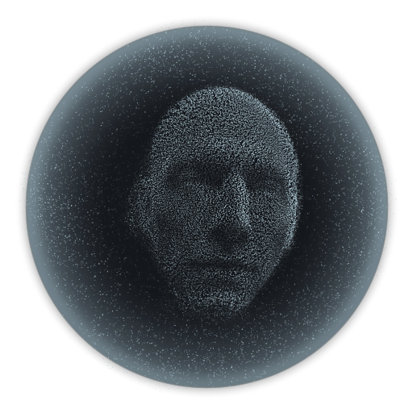

<p align="center">
  
</p>

<h1 align="center">Autum</h1>

<p align="center">
  <strong>Local, model-agnostic voice-first AI assistant for Linux.</strong><br/>
  A floating 3D stardust orb powered by local <a href="https://ollama.com">Ollama</a> models and PipeWire audio — zero cloud dependencies.
</p>

<p align="center">
  <a href="https://github.com/GeneticxCln/Autum/releases"></a>
  <a href="https://github.com/GeneticxCln/Autum/actions/workflows/ci.yml"></a>
  
</p>

---

## Features

- **3 Listening Modes** (switch live via right-click orb menu or Settings):
  - **Push-to-Talk** — hold the orb to talk, drag anywhere on screen.
  - **Wake Word (`"Autum"`)** — ignores room/TV chatter until you call `"Autum"` / `"Hey Autum"`, with a 12 s follow-up window.
  - **Hands-Free** — continuous Silero VAD conversation with speaker echo filtering and barge-in.
- **Model-Agnostic Local AI** — pick any locally installed Ollama models for **Brain/Chat**, **Vision**, and **Voice (STT/TTS)** in Settings with dynamic GPU VRAM swapping.
- **Local Tools & Desktop Control** — clock, timers, local notes, persistent memory, scoped document/image reading, live opt-in screen watch, KDE Plasma / KWin window management, app launching, and built-in self-diagnosis.
- **Privacy by Default** — localhost-only Ollama, fail-closed `allowed_read_dirs`, excluded password/wallet windows, secret redaction in logs, and explicit approval for destructive actions.

## Install

Download the latest release from [**Releases**](https://github.com/GeneticxCln/Autum/releases):

| Package | Command |
| :--- | :--- |
| **AppImage** (any Linux distro) | `chmod +x Autum-*-x86_64.AppImage && ./Autum-*-x86_64.AppImage` |
| **Debian / Ubuntu (`.deb`)** | `sudo apt install ./autum_*_all.deb` |
| **Fedora / openSUSE (`.rpm`)** | `sudo dnf install ./autum-*.noarch.rpm` |
| **From source** | `pip install ".[desktop]" && autum` |

## Prerequisites & Recommended Models

1. **Linux with PipeWire** (`pw-record`, `pw-play`, `wpctl`) and [**Ollama**](https://ollama.com) running locally.
2. Pull any models you prefer (recommended 16 GB GPU setup — 100% GPU with ~3 GB desktop headroom):
   ```bash
   ollama pull lfm3-omni:2b   # Voice STT + TTS (~1.6 GB)
   ollama pull gemma4:12b     # Brain / Chat (~8.0 GB)
   ollama pull qwen3-vl:8b    # Vision (~6.2 GB, swapped on demand)
   ```
3. Launch **Autum** from your app menu or run `autum`. Right-click the orb to switch listening mode, open **Settings** (shows version & live model pickers), or run **Self-Diagnose**.

## Development

```bash
PYTHONPATH=src python3 -m pytest -q
PYTHONPATH=src python3 -m autum
```
